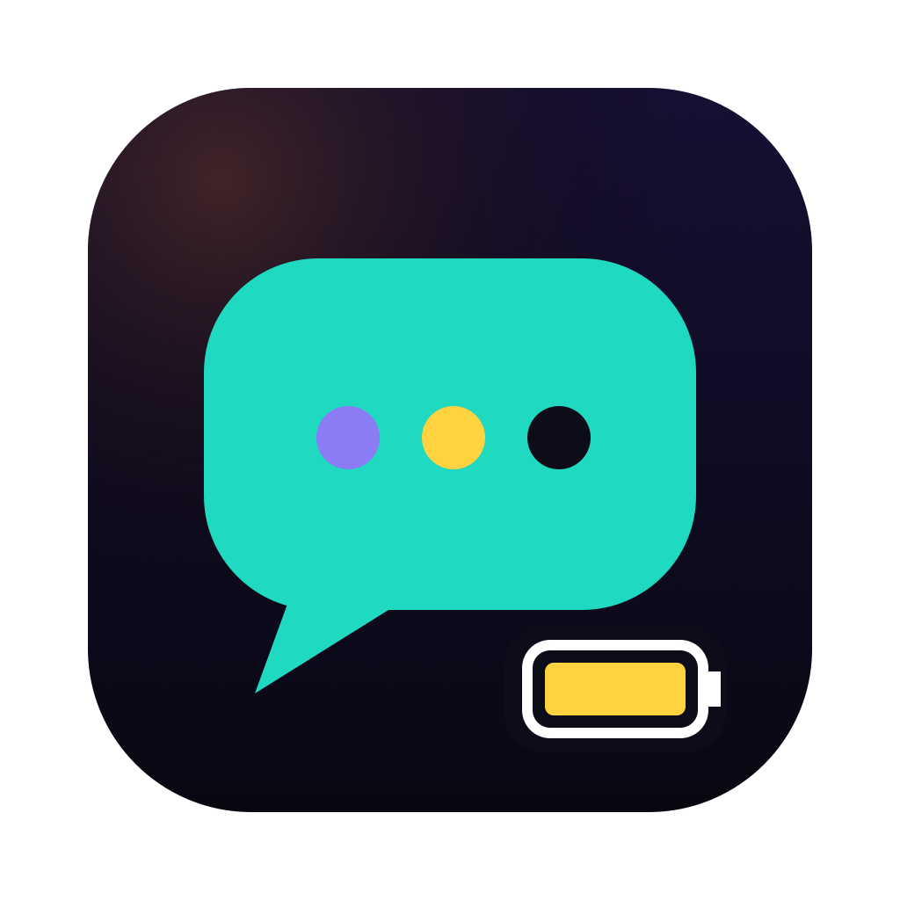

<p align="center"></p>

# iMessage MCP: iMessage for AI tools, without Full Disk Access

**iMessage MCP is a free, open-source macOS app and MCP server. It lets Claude Code, Codex or any MCP client read, search and send your Messages (iMessage/SMS) while your data stays on your Mac. It does not need Full Disk Access.**

You pick your Messages folder once in a normal macOS panel. The app keeps a read-only bookmark to it inside the macOS sandbox, has no network access, and asks you to approve every connection and every message it sends.

- **No Full Disk Access.** Verified on macOS 27.0.1 with real messages. No system-wide permission is granted. Sending a message asks macOS once for permission to control Messages only.
- **Your data stays safe.** Sandboxed, read-only, no network entitlement. Text leaves your Mac only if the AI tool you connect sends it elsewhere, so each connection needs your approval and runs under limits you set.
- **You are in control.** Choose how long the bridge runs and how many messages can be read. A battery shows the time left. Stop with one click.
- **Sending always asks.** The exact recipient and full text are shown, and nothing is sent until you press *Send this message*.
- **Works without AI too.** Search and read your messages inside the app.

## Install

Requires macOS 13 or later.

**1. Install the app**

Option A, download (signed and notarized by Apple, nothing to build):

```bash
brew install --cask 0xroots/tap/imessage-mcp
```

or download the DMG from the [latest release](https://github.com/0xroots/imessage-mcp/releases/latest) and drag **iMessage MCP** to Applications. The checksum is published next to the DMG.

Option B, build from source (needs Xcode command line tools; a free Apple Development certificate is enough):

```bash
git clone https://github.com/0xroots/imessage-mcp
cd imessage-mcp
security find-identity -v -p codesigning        # note your identity and its Team ID
export MSGLOCAL_SIGN_IDENTITY="Apple Development: Your Name (XXXXXXXXXX)"
export MSGLOCAL_TEAM_ID="YOURTEAMID"
./scripts/install.sh                            # add --claude and/or --codex to register the server for you
```

Your identity and Team ID stay in your shell, never in the repository. The app and its adapter verify each other's code signature against that Team ID.

**2. Connect your AI tool**

| Client | How |
|---|---|
| **Claude Code** (plugin) | `/plugin marketplace add 0xroots/imessage-mcp` then `/plugin install imessage-mcp@imessage-mcp` |
| **Claude Code** (command) | `claude mcp add --scope user --transport stdio imessage-mcp -- /Applications/iMessageMCP.app/Contents/Helpers/messages-mcp "$HOME/Library/Containers/org.messageslocal.app/Data/tmp/messages-mcp.sock"` |
| **Codex** (plugin) | `codex plugin marketplace add 0xroots/imessage-mcp` then `codex plugin add imessage-mcp@imessage-mcp` |
| **Codex** (command) | `codex mcp add imessage-mcp -- /Applications/iMessageMCP.app/Contents/Helpers/messages-mcp "$HOME/Library/Containers/org.messageslocal.app/Data/tmp/messages-mcp.sock"` |
| **ChatGPT and dots** | Through OpenAI's Secure MCP Tunnel: `./scripts/chatgpt-tunnel.sh`. See [docs/CHATGPT.md](docs/CHATGPT.md) |
| **Any MCP client** | Add a stdio server with the same command and one argument, the socket path. See [docs/MCP_SETUP.md](docs/MCP_SETUP.md) |

The plugin adds the MCP server and a skill that teaches the assistant the safe way to use it. It needs the app from step 1. If you installed the app somewhere else, set `IMESSAGE_MCP_APP` to its path.

## Use it

1. **Allow the Messages folder.** Click *Allow Messages folder* and select `~/Library/Messages`. Access is read-only.
2. **Start the AI bridge** and choose your limits.
3. **Connect a tool.** Add the adapter to your MCP client (see [docs/MCP_SETUP.md](docs/MCP_SETUP.md)). The first time it connects, iMessage MCP asks you to approve it: *Selected chat*, *All chats* or *Deny*.
4. **Stop the bridge** with one click, or wait for the timer (the battery) to run out. Everything is revoked immediately.

## What a connected tool can do

| Tool | Purpose |
|---|---|
| `list_conversations` | List chats you allowed |
| `get_messages` | Read messages from an allowed chat, with paging |
| `search_messages` | Search text, with direction and date filters |
| `get_recent_messages` | Messages since a date |
| `get_attachment_metadata` | Attachment names, types and sizes, with an index for each |
| `get_attachment` | One photo or PDF as images and text. On by default; switch it off in the start dialog or any time with *Photos and PDFs for AI* in the app window |
| `send_message` | Send one message after your on-screen confirmation |

Limits apply across every connection for the whole run. Some message bodies use formats that cannot be decoded yet; they are returned as unsupported and are never guessed.

## Security model in one minute

- Read-only, app-scoped bookmark to the Messages folder; no Full Disk Access.
- No network entitlement. Message text leaves your Mac only if the tool you connect sends it elsewhere, which is why you approve each connection.
- The adapter and the app authenticate each other by code signature and Team ID.
- Sending uses a single Apple Event to Messages, needs a fresh confirmation each time, rejects repeated request IDs, and never retries on an unknown result.

Details, limits and the threat model: [SECURITY.md](SECURITY.md).

## Privacy

Everything runs on your Mac with no network code and no account. The message browser needs Touch ID or your Mac password, so an AI that controls your screen cannot read messages around the bridge. See [PRIVACY.md](PRIVACY.md).

## FAQ

**Does it need Full Disk Access?** No. You choose the Messages folder in the standard file panel and the app gets a read-only, app-scoped bookmark.

**Is my data sent anywhere?** The app has no network entitlement. Message text leaves your Mac only if the AI tool you connect sends it elsewhere. That is why you approve each connection and set limits.

**Can an AI tool send messages without asking me?** No. Every message needs your confirmation in a window that shows the recipient and the full text.

**Which AI tools work?** Any client that supports stdio MCP servers, including Claude Code and Codex.

**What does it not do?** It reads attachment contents only for photos and PDFs (up to 15 MB each, 40 MB per run) while the *Photos and PDFs for AI* switch is on, never video or audio, cannot decode every archived message body yet, and cannot confirm delivery of sent messages.

## Development

```bash
./scripts/test.sh       # unit tests, no signing or Messages access needed
./scripts/build.sh      # build and sign
```

Layout: `Sources/App` (interface), `Sources/Bridge` (local server, limits, approvals, sending), `Sources/Reader` (read-only SQLite reader and body decoder), `Sources/Adapter` (stdio MCP adapter), `Tests`.

## Known limitations

- Some archived message bodies cannot be decoded and are marked unsupported.
- The request-ID journal holds 1,000 IDs and fails closed when full; there is no reset yet.
- Delivery of a sent message is not confirmed by the app; check Messages.
- Same-user processes can launch the adapter, so approve only requests you started.

## License

MIT. See [LICENSE](LICENSE).
